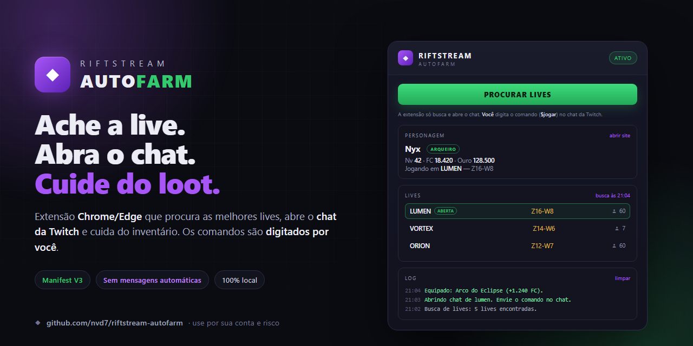
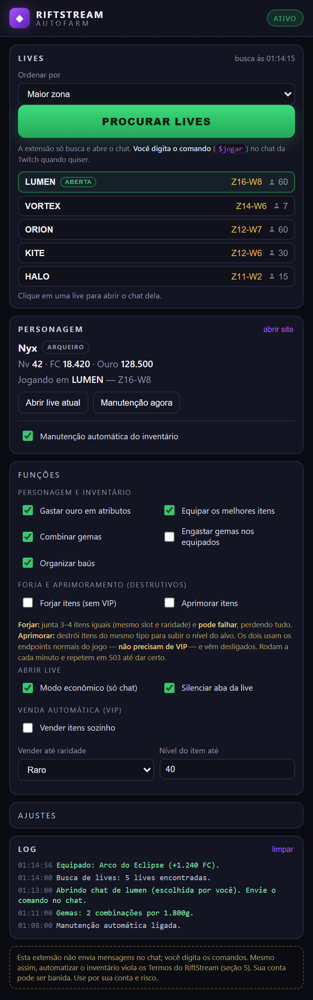

<p align="center">
  
</p>

<h1 align="center">RiftStream AutoFarm</h1>

<p align="center">
  Extensão <strong>Chrome/Edge (Manifest V3)</strong> para o RPG de chat do
  RiftStream: encontra as melhores lives da Twitch, abre o chat que você
  escolher e cuida do inventário. <strong>Você</strong> digita os comandos.
</p>

<p align="center">
  <a href="https://developer.chrome.com/docs/extensions/develop/migrate"></a>
  <a href="LICENSE"></a>
  <a href="CHANGELOG.md"></a>
  
  
  <a href="https://github.com/nvd7/riftstream-autofarm/actions/workflows/validar.yml"></a>
</p>

<p align="center">
  <a href="#sobre">Sobre</a> ·
  <a href="#recursos">Recursos</a> ·
  <a href="#requisitos">Requisitos</a> ·
  <a href="#instalação">Instalação</a> ·
  <a href="#como-usar">Como usar</a> ·
  <a href="#configuração">Configuração</a> ·
  <a href="#como-funciona">Como funciona</a> ·
  <a href="#solução-de-problemas">Solução de problemas</a>
</p>

<p align="center">
  
</p>

> [!IMPORTANT]
> **A extensão não envia mensagens no chat.** Ela só busca as lives e abre o
> chat da Twitch. Os comandos (`$jogar`, `$me`…) são digitados **por você**.
> O único trabalho automático é a **manutenção do inventário** (equipar itens
> melhores, combinar gemas, forjar e aprimorar), que usa a API oficial do site e
> **não passa pelo chat**. Cada função tem um **interruptor no menu**.

> [!WARNING]
> **Automatizar o inventário viola os Termos do RiftStream.** A seção 5 proíbe o
> uso de bots, scripts ou programas que automatizem o jogo. **Sua conta pode ser
> suspensa ou banida.** Este projeto é fornecido como está, sem garantia e sem
> vínculo com o RiftStream, a Twitch ou a Amazon. Use preferencialmente uma
> conta alternativa e por sua conta e risco.

> [!NOTE]
> **Status: v1.2.1.** Busca de lives, abertura de chat, equipar, gemas, forja,
> aprimoramento, engaste, organização e venda automática estão implementados.
> **Forja e aprimoramento não precisam de VIP** — usam os mesmos endpoints do
> site (`/api/me/items/fuse` e `/api/me/items/enhance`); só o “fundir tudo” e a
> venda automática são exclusivos de VIP. Os endpoints seguem a API observada no
> front-end atual; mudanças no RiftStream podem exigir ajustes. O primeiro uso
> deve ser supervisionado.

---

## Sobre

O **RiftStream** é um RPG que roda no chat da Twitch: a live precisa estar no ar,
com o bot presente no chat, e o personagem progride enquanto você está em um
canal. O **AutoFarm** ajuda nesse ciclo, sem falar por você:

1. Você clica em **Procurar lives**.
2. A extensão consulta o ranking público e mostra as lives online, ordenadas por
   **zona/onda** (ou por público, se preferir).
3. Você escolhe uma live e a extensão **abre o chat** dela na Twitch.
4. **Você** manda o comando no chat (`$jogar arqueiro`, por exemplo) pelo seu
   próprio teclado.
5. Se quiser, ative a **manutenção automática do inventário**: a extensão compara
   os itens com a FC, equipa o que for melhor, combina gemas e, se você ligar,
   forja e aprimora itens sem VIP.

Tudo acontece na sua máquina. O token de login fica no `chrome.storage.local` e
é usado apenas para chamar a API oficial do RiftStream.

---

## Recursos

- **Procurar lives (manual):** nada é escolhido sozinho. Você clica no botão e
  recebe a lista das lives online, com zona, onda e público.
- **Ordenação configurável:** maior zona, mais jogadores ou equilibrado.
- **Suas abas contam:** lives que você já tem abertas na Twitch aparecem no topo
  da lista, marcadas como **aberta** — mesmo se o ranking falhar.
- **Abre o chat pronto para digitar:** no modo econômico abre o popout de chat
  (`twitch.tv/popout/{canal}/chat`), silencia a aba e tira o descarte automático.
  O campo do chat já vem focado para você digitar o comando.
- **Nenhuma mensagem automática:** a extensão nunca digita no chat. Slow mode,
  followers-only e sub-only deixam de ser problema.
- **Manutenção por FC:** usa `GET /api/me/items/{id}/compare` e só equipa quando
  `newPower > power`, testando os melhores candidatos de cada slot.
- **Gastar ouro:** sobe os atributos do personagem (`str`, `vit`, `def`, `agi`,
  `luk`) com prioridade equilibrada ou um atributo escolhido, sempre respeitando o
  ouro reservado.
- **Gemas:** executa o mesmo “combinar todas” do site e respeita o ouro
  disponível.
- **Forja sem VIP:** roda a cada minuto, monta todos os grupos de 3–4 itens do
  mesmo slot e raridade e chama o endpoint normal da forja. As regras são as
  mesmas do site e a reserva de ouro é respeitada; em 503 a extensão insiste e
  confere o inventário antes de repetir.
- **Aprimoramento sem VIP:** roda a cada minuto, usa a prévia oficial de custo e
  destrói apenas itens mais fracos do mesmo slot — nunca equipados, favoritos ou
  com gemas.
- **Menu de funções:** cada automação tem seu próprio interruptor; as destrutivas
  (forja e aprimoramento) vêm desligadas.
- **Extras opcionais:** engastar gemas nos itens equipados, organizar baús por
  nível e configurar a venda automática (VIP).
- **Tolerância a falhas:** leituras (GET) são repetidas em 503/erro de rede; a
  lista de lives não é apagada por erro transitório e a sessão expirada é
  detectada. **Forja e aprimoramento rodam a cada minuto** e repetem a escrita
  em 503 conferindo o inventário, sem aplicar duas vezes.
- **Painel em PT-BR:** personagem, lives encontradas, configurações e log com
  timestamp. Tudo local, sem telemetria.

---

## Requisitos

| Item | Recomendado |
|---|---|
| Navegador | Chrome, Edge, Brave ou outro Chromium recente (Manifest V3) |
| Conta Twitch | Logada **no navegador normal**, com o chat funcionando |
| Conta RiftStream | Login feito com a Twitch em `riftstream.com.br` |
| Aba da Twitch | Pode ficar em segundo plano; o navegador deve continuar aberto |
| Sistema | Windows, macOS ou Linux (a extensão é multiplataforma) |
| Rede | Acesso a `riftstream.com.br`, à API do site e à Twitch |

> [!NOTE]
> Navegadores embutidos (Electron, painéis de aplicativos e modos de visualização
> internos) **não servem** para o chat da Twitch. Instale a extensão no seu
> Chrome/Edge/Brave normal, onde você já usa a Twitch.

---

## Instalação

A extensão não está publicada na Chrome Web Store. A instalação é feita em modo
de desenvolvedor, direto da pasta do projeto.

1. Baixe a **última release**
   (<https://github.com/nvd7/riftstream-autofarm/releases>) e extraia em uma pasta
   fixa, por exemplo `C:\RiftStreamAutoFarm`.
2. Abra `chrome://extensions` (ou `edge://extensions`).
3. Ative o **Modo do desenvolvedor** no canto superior direito.
4. Clique em **Carregar sem compactação** / **Load unpacked**.
5. Selecione a pasta que contém o `manifest.json`.
6. Fixe o ícone **RiftStream AutoFarm** na barra de extensões.

> [!TIP]
> Se o navegador avisar que a extensão pode ler dados do site, isso é esperado:
> ela precisa acessar a API do RiftStream e a aba da Twitch para funcionar.
> Nenhum dado é enviado para servidores do projeto.

### Atualizar

1. Substitua os arquivos da pasta pelos da versão nova.
2. Abra `chrome://extensions` e clique no ícone de **recarregar** no cartão da
   extensão.
3. Recarregue a aba da Twitch aberta pela extensão e reabra o painel.

As configurações e o token continuam salvos entre atualizações.

---

## Como usar

### Primeiro uso

1. Abra <https://riftstream.com.br/character> e entre com a Twitch.
2. Clique no ícone da extensão.
3. Clique em **PROCURAR LIVES** e espere a lista aparecer.
4. Escolha uma live. A extensão abre o **chat** dela na Twitch com o campo
   pronto para digitar.
5. No chat, mande o comando você mesmo: `$jogar arqueiro` (ou a sua classe).
6. (Opcional) Marque **Manutenção automática do inventário** e escolha em
   **Funções** o que ela pode fazer (equipar, gemas, atributos, forja…).

O personagem aparece alguns segundos depois do `$jogar`. Se a live não tiver o
bot do RiftStream, tente outra da lista.

### O que o painel mostra

| Área | Conteúdo |
|---|---|
| **Lives** | Lista das lives online (zona/onda/público) e o botão **Procurar lives** |
| **Personagem** | Nome, classe, nível, FC, ouro e canal atual |
| **Funções** | Um interruptor para cada automação do inventário |
| **Ajustes** | Intervalos, filtros, ouro reservado e prioridade dos atributos |
| **Log** | Últimas ações, avisos e erros com horário |

### Ordenação

- **Maior zona** — prioriza a zona mais alta, onde o loot costuma ser melhor.
- **Mais jogadores** — prioriza público; chefes e eventos caem mais rápido.
- **Equilibrado** — mistura zona, onda e público.

Isso muda apenas **a ordem da lista**. A escolha de entrar em uma live é sempre
sua.

### Comandos (no chat da Twitch, digitados por você)

| Comando | Para que serve |
|---|---|
| `$jogar guerreiro` | Entra no canal com a classe escolhida |
| `$jogar clerigo` | Idem, clérigo |
| `$jogar arqueiro` | Idem, arqueiro |
| `$me` | Mantém o personagem ativo antes do AFK (30 min normal, 2 h VIP) |

> [!TIP]
> Sem argumento, `$jogar` deixa o jogo escolher a classe **menos populosa**, o
> que pode trocar a sua. Por isso o exemplo acima manda a classe junto.

### Parar

Feche a aba da Twitch quando não quiser mais jogar. Se a manutenção automática
estiver ligada, desmarque **Manutenção automática do inventário** para ela parar
de rodar.

---

## Configuração

As opções ficam no painel e são salvas automaticamente em
`chrome.storage.local`.

| Opção | Padrão | Descrição |
|---|---:|---|
| `strategy` | `zone` | Ordem da lista: `zone`, `players` ou `balanced` |
| `maintenanceMin` | `5` | Intervalo da manutenção automática, em minutos (2–60) |
| `minPlayers` | `3` | Esconde da lista as lives com menos jogadores que isso |
| `goldReserve` | `50000` | Ouro que nunca é gasto (atributos, forja, aprimoramento, engaste e venda) |
| `autoStats` | `true` | Gasta ouro subindo atributos |
| `statPriority` | `balanced` | `balanced` (mais barato), `str`, `vit`, `def`, `agi` ou `luk` |
| `autoEquip` | `true` | Equipa automaticamente o melhor item por slot |
| `autoGems` | `true` | Combina gemas de 3 em 3 |
| `autoForge` | `false` | Forja itens pelos endpoints normais, sem VIP (destrutivo) |
| `autoEnhance` | `false` | Aprimora itens destruindo os mais fracos (destrutivo) |
| `autoSocket` | `false` | Engasta gemas nos itens equipados |
| `autoOrganize` | `true` | Organiza os baús por nível |
| `autoSell` | `false` | Configura a venda automática (**VIP**) |
| `sellRarity` | `2` | Vende até esta raridade (`-1` desliga, `3` = épico) |
| `sellLevel` | `40` | Vende itens até este nível |
| `chatOnly` | `true` | Abre só o chat (menos banda) em vez da live completa |
| `muteTab` | `true` | Silencia a aba da Twitch |

> [!TIP]
> A manutenção automática só roda com a extensão **ativa** (o botão no topo do
> painel mostra `ativo`). Ela precisa de um token válido: tenha
> `riftstream.com.br` aberto e logado.

---

## Como funciona

```text
ranking público ──► lista de lives ──► você escolhe ──► chat da Twitch
                                                            │
                                                            └─ você digita $jogar/$me

API do RiftStream ──► personagem ──► manutenção (atributos/equipar/gemas/forja)
```

### Busca de lives

1. `GET /api/ranking/runs?online=true` e `GET /api/ranking/crowds?online=true`
   listam as lives em destaque.
2. Para cada candidato, `GET /api/ranking/channel/{login}` confirma `live`,
   `online`, `zone`, `wave`, `playersNow` e o `twitchLogin`.
3. Canais que só existem na Kick são descartados.
4. As lives que você já tem abertas na Twitch entram na lista, marcadas como
   **aberta**, mesmo que o ranking falhe.
5. A ordem depende da estratégia:
   - `zone`: `zona × 1000 + onda × 10 + log(público) × 50`
   - `players`: `público × 1000 + zona × 100 + onda`
   - `balanced`: `(zona × 100 + onda) × 10 + público limitado a 250 + log`

### Abrir a live

- No modo econômico, a extensão abre
  `https://www.twitch.tv/popout/{login}/chat?popout=` e foca o campo do chat.
- Desmarcando **Modo econômico**, ela abre a live completa
  (`https://www.twitch.tv/{login}`).
- A aba é silenciada (se marcado) e marcada como `autoDiscardable: false`.
- **Nenhuma mensagem é enviada.** A extensão não lê nem escreve no seu chat.

### Manutenção do inventário

| Ação | Endpoint | Regra |
|---|---|---|
| Gastar ouro | `POST /api/me/character/stats/{atributo}` | `{ amount: 1 }`; prioridade e reserva de ouro |
| Equipar | `POST /api/me/items/{id}/equip` | Só se `newPower > power` no `compare` |
| Combinar gemas | `POST /api/me/gems/combine-all` | Respeita `merges`, `cost` e `canAfford` |
| Forjar | `POST /api/me/items/fuse` | 3–4 itens do mesmo slot/raridade; sem VIP |
| Aprimorar | `POST /api/me/items/enhance` | Prévia em `/enhance/preview`; doadores mais fracos |
| Engastar | `POST /api/me/items/{id}/socket` | Gema de maior tier disponível |
| Organizar | `POST /api/me/items/organize` | A cada 6 horas, se ativado |
| Venda automática | `PUT /api/shop/autosell` | VIP; aplica raridade e nível |

Se a API recusar um recurso VIP, a opção é desativada e o motivo aparece no log.
Forja e aprimoramento **não são VIP**: só o atalho “fundir tudo” e a venda
automática exigem assinatura.

### Permissões

| Permissão | Por quê |
|---|---|
| `storage` | Salvar token, configurações, timers e log localmente |
| `alarms` | Executar a manutenção a cada minuto mesmo com o service worker dormindo |
| `tabs` | Abrir, reutilizar, silenciar e impedir o descarte da aba da Twitch |
| `scripting` | Ler o token do site caso o content script ainda não tenha carregado |
| `riftstream.com.br` | Ler `localStorage["og.token"]` e chamar a API oficial |
| `twitch.tv` | Abrir a aba e focar o campo do chat (sem enviar mensagens) |

---

## Estrutura do projeto

```text
manifest.json           permissões, ícones e injeção dos scripts
background.js           service worker: ranking, abas e manutenção da API
content/riftstream.js   ponte do token (localStorage → extensão)
content/twitch.js       foca o campo do chat (não envia nada)
popup/                  painel de controle (HTML/CSS/JS)
icons/                  ícones 16, 48 e 128 px
docs/                   banner, screenshot e documentação técnica
tools/validate.mjs      validação usada localmente e no GitHub Actions
.github/                workflow, templates de issue e pull request
```

Documentação adicional:

- [Arquitetura](docs/ARQUITETURA.md) — componentes, estado, ciclo e tratamento
  de falhas.
- [Validação supervisionada](docs/VALIDACAO.md) — roteiro de teste completo.
- [Checklist de release](docs/RELEASE.md) — como publicar uma versão.
- [Privacidade](PRIVACY.md) — o que é armazenado e transmitido.
- [Segurança](SECURITY.md) — como reportar vulnerabilidades.

---

## Limitações

- **A extensão não entra na live por você.** Ela mostra a lista e abre o chat; o
  `$jogar` é seu.
- **Não há troca automática de live.** Se a atual cair, procure outra no painel.
- **Forja e aprimoramento são destrutivos.** A forja pode falhar e perder os
  itens usados; o aprimoramento destrói os doadores. As duas opções vêm
  desligadas e nunca usam VIP.
- **A venda automática é VIP.** Sem VIP, a API recusa e a extensão desativa a
  opção.
- **Canais exclusivos da Kick são ignorados.** O foco é o chat da Twitch.
- **O navegador precisa ficar aberto.** Fechar o navegador interrompe a
  manutenção automática.
- **Mudanças no site podem quebrar a extensão.** A API e os seletores do chat
  foram observados no front-end atual; atualize o projeto se algo mudar.
- **A manutenção mexe no seu inventário.** Ela só equipa o que aumenta a FC, mas
  vale revisar as opções antes de deixar rodando.

---

## Solução de problemas

| Sintoma | Causa provável | O que fazer |
|---|---|---|
| “O ranking não retornou nenhuma live online agora” | Nenhuma live com bot no ar no momento | Tente de novo em alguns minutos; se você já está em uma live, ela aparece marcada como **aberta** |
| “Não consegui consultar o ranking” | API fora do ar, rede ou bloqueio | Verifique a internet, o bloqueador de anúncios e tente **Procurar lives** novamente |
| A lista está vazia mas eu estou em uma live | A aba não foi reconhecida como canal | Use uma URL `twitch.tv/{canal}` ou o popout de chat; evite páginas como `/directory` |
| “Sem login detectado” | Token ausente ou sessão expirada | Abra `riftstream.com.br/character`, entre de novo e reative a manutenção |
| “Não consegui falar com a extensão” | Service worker reiniciou ou a extensão foi recarregada | Feche e abra o painel; se persistir, recarregue a extensão |
| Personagem não aparece | Bot ausente ou `$jogar` ainda processando | Confira se você mandou `$jogar` no chat; aguarde ou troque de live |
| Manutenção não roda | Está desligada ou sem token | Marque **Manutenção automática do inventário** e confirme o site logado |
| Forja/venda desativada | Conta sem VIP (venda) ou API recusou a forja | Para forjar, confira ouro e itens iguais; para vender, reative depois de virar VIP; veja o log |
| “RiftStream indisponível agora” | 503 intermitente do servidor | Espere alguns segundos e clique em **Procurar lives** de novo; a extensão já repete leituras |
| Aba da Twitch descartada | Economia de memória do navegador | Desative a economia para a aba ou mantenha o navegador ativo |
| Erro 401/403 no log | Token expirado ou permissão insuficiente | Faça login de novo no site e reative a manutenção |

> [!NOTE]
> Ao relatar um problema, copie o **log do painel** e informe navegador, versão
> da extensão e o canal usado. **Nunca publique o token** (`og.token`) nem o
> conteúdo de `chrome.storage.local`.

---

## Privacidade

- **Sem telemetria.** O projeto não coleta estatísticas, não usa analytics e não
  envia dados para servidores próprios.
- **Nenhuma mensagem no chat.** A extensão não lê nem escreve no chat da Twitch;
  ela apenas abre a aba e foca o campo de digitação.
- **Token local.** O token do RiftStream é lido do site e guardado em
  `chrome.storage.local`; ele é enviado apenas para a API oficial do RiftStream.
- **Rede.** As únicas conexões são com `riftstream.com.br`, com a API do site e
  com `twitch.tv` (abrir a aba).
- **Logs.** Ficam no armazenamento da extensão e podem ser limpos no painel.
- **Remoção.** Desinstalar a extensão apaga token, configurações, timers e log.

Detalhes em [PRIVACY.md](PRIVACY.md).

---

## Desenvolvimento

Não há etapa de build: o navegador carrega os arquivos diretamente.

```powershell
# Validação local (manifest, arquivos, sintaxe e links da documentação)
node tools/validate.mjs
```

Para testar uma alteração:

1. Edite os arquivos.
2. Em `chrome://extensions`, clique em **recarregar** no cartão da extensão.
3. Recarregue a aba da Twitch e reabra o painel.
4. Acompanhe o log no painel e o console do service worker
   (**Inspecionar views → service worker**).

O workflow [`.github/workflows/validar.yml`](.github/workflows/validar.yml)
executa a mesma validação em cada push e pull request. Leia
[CONTRIBUTING.md](CONTRIBUTING.md) antes de abrir uma issue ou PR.

---

## Aviso legal

Este projeto é independente e **não é afiliado, associado ou endossado** pelo
RiftStream, pela Twitch ou pela Amazon. “RiftStream” e “Twitch” pertencem aos
seus respectivos titulares.

O software é distribuído sob a licença MIT, **sem garantia de qualquer tipo**.
A automação do inventário pode violar os Termos de Serviço das plataformas
envolvidas e resultar em suspensão ou banimento da conta. Você é o único
responsável pelo uso.

## Licença

[MIT](LICENSE) © 2026 nvd7
